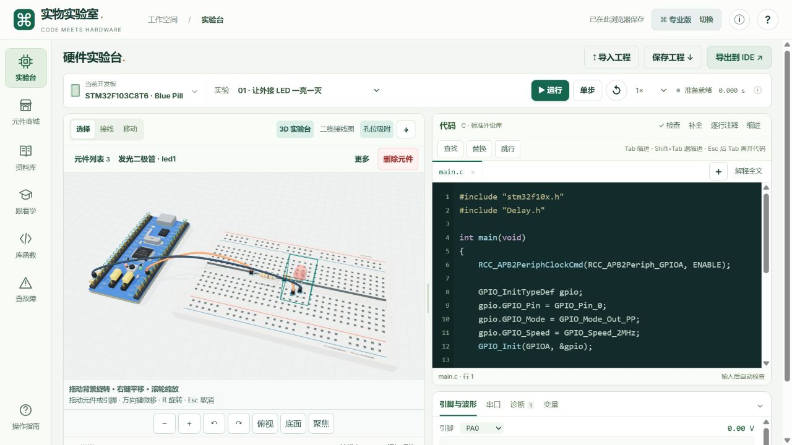
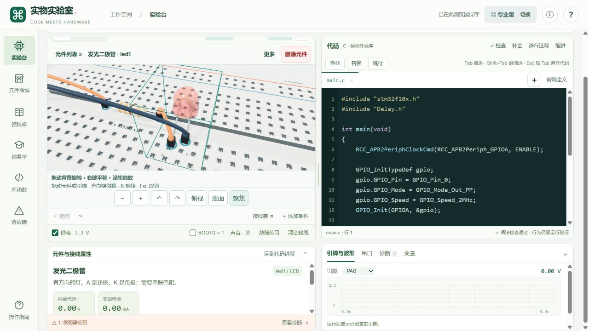
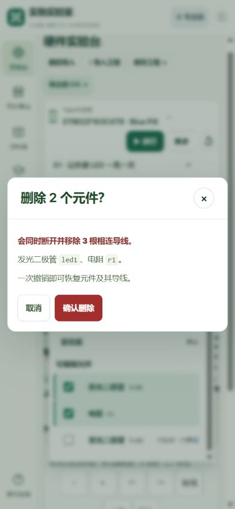

# 硬件实物实验室 V4 · 三维与元件操作十轮记录

2026 年 11 月 6 日。基线是线上 V3，源码提交 `b57612fb718589cf81cbb3692b667f7dab0b89c8`。先读 [V3 十轮记录](ten-round-review.md)，再在原站进入专业版，确认默认是 SVG，手动点 3D 才进入 WebGL。V3 自动化基线为 167 项通过。

| 轮次 | 发现 | 修改 | 验证 |
| --- | --- | --- | --- |
| 1 · 场景入口 | V3 默认初始化二维视图，部分平板宽度还会隐藏 3D 入口。 | 默认初始化 WebGL，首次可见时适配画布。二维单独标注为接线图，初始化失败或上下文丢失时显示明确的兼容提示。 | 实际浏览器进入后呈现可交互 Canvas。切换二维和三维后同一 LED 仍选中。1024px 布局里两种视图入口和编辑器都可见。 |
| 2 · 模型几何 | 面包板孔是叠在实心表面上的矩形，LED 内部结构简化，Blue Pill 底面可读性差。 | 重建 400 个真实开口、下沉弹片、电源轨和中间槽。Blue Pill 补充板层边缘、背面丝印、焊盘和排针。LED 加入透明封装、反光杯与金属引线，电阻与杜邦线补充弯脚、色环和插头结构。 | 几何测试向孔口和孔壁发射射线，检查开口穿透、凹槽和空心排座。实际浏览器复验斜视对比度、LED 特写与底面。 |
| 3 · 视角与画布 | 默认角度不便近看，首次进入和小窗口容易出现画布尺寸不合适。 | 提供绕视、缩放、俯视、底面和聚焦所选，保留右拖平移。调整控件与画布的最小尺寸，属性展开后仍能操作。 | 鼠标拖空白处后 PCB 朝向改变，滚轮放大。点底面看到排针和 PCB 背面。聚焦 LED 后看到引脚、杜邦头和孔壁。 |
| 4 · 删除保护 | V3 的元件删除埋在属性面板，删除时直接移除导线，Delete 主要作用于导线。 | 选中时显示高亮和常驻删除按钮。加入右键菜单、Delete / Backspace、有线及批量删除确认和专用撤销。确认默认聚焦取消。 | 模型点击和右键均选中 `led1`。Backspace 显示 2 根受影响导线。取消保持 2 个元件，确认后变 1 个，专用撤销恢复 2 个和 `2 / 2` 引脚接线。 |
| 5 · 摆放与接线 | 元件移动缺少孔位定位，三维没有完整键盘接线路径，端点预览与重接需要一致的状态。 | 按真实引脚偏移吸附邻近孔位，可关闭或按 Alt 暂停。拖动时曲线导线跟随端点。加入键盘选脚、有效端点预览与明确的接线提交。 | 拖动 LED 后两根原导线继续连接。实际按 P、Enter、右方向键、Enter 新接 `led1:A → led1:K`，再撤销接线与移动。专项测试验证最近孔位和导入坐标边界。 |
| 6 · 元件层级 | 缺少从列表找元件和一次处理多个元件的方式。 | 加入按设备、面包板、元件分组的列表。支持 Shift 点击和复选框多选、90° 旋转、复制、锁定、隐藏。锁定保护位置、角度和删除，隐藏保持电气状态。 | 两个元件共用一根导线时，删除确认统计 3 根唯一导线。浏览器验证复制产生 `led2`、锁定后删除和旋转按钮禁用，以及隐藏后可从列表显示。专项测试核对副本参数和隐藏电气连续性。 |
| 7 · 性能 | 空闲时持续绘制，每次更新重复写入大量孔位颜色。 | 改为有变化才绘制，隐藏画布停止绘制，缓存孔位状态。面包板使用实例化几何，降低标签纹理和阴影缓冲尺寸。 | 几何回归通过。实际浏览器从运行、暂停切到拖动、接线、缩放和模式切换，画面继续按需更新。阴影缓冲从 2048² 改为 1024²，此处记录资源配置变化。 |
| 8 · 窄屏与无障碍 | 窄屏常用操作不集中，三维缺少键盘引脚说明和稳定焦点。 | 响应式保留两种视图按钮，窄屏删除、勾选与相机按钮使用至少 44px 高的操作区。补充可读标签、聚焦反馈、键盘提示和双指视角处理。 | 390px 页面无横向溢出，画布高 260px，删除按钮和勾选区域高 44px。实际窄屏勾选、确认、批量删除和撤销。1024px 可同屏查看编辑器。触屏手势尚无实体设备验收。 |
| 9 · 工程往返 | 导出包含元件状态，但 V3 导入校验会丢弃锁定和隐藏。瞬时按键可能以按下状态恢复。 | 新旧格式兼容，校验并保留锁定、隐藏、旋转。瞬时按键恢复为松开，拨动开关状态照常保存。 | 实际下载 JSON，再通过导入预览应用，核对 `led2` 锁定与隐藏均恢复。自动化验证真实 ZIP 备份往返、原代码、端点、角度与错误预检。 |
| 10 · 仿真与故障一致性 | 断路练习按通用 `:K` 匹配，失败操作也可能进入撤销记录，GPIO 时钟练习会牵连同一调用的其他外设。 | 先验证故障目标再改动。断路定位 LED 的实际 K 端，短路识别电源别名，时钟练习仅修改受支持的 F1 SPL GPIO 位。接线变化后更新场景、参数面板与求解结果。商城区分精细 3D、板型及封装示意、资料选型。 | 实际运行点灯代码观察到约 3.62 mA；故障练习把 LED 接线从 `2 / 2` 改为 `1 / 2`，撤销恢复。GPIO 时钟源码修改可撤销。测试覆盖 ADC 时钟保留、GPIO 报错、过流、重复短路和商城分层。 |

## 验收结果

- 190 项自动化测试通过，0 失败、0 跳过。22 个 `dist/` 顶层 JavaScript 文件通过语法检查。
- 浏览器验收使用桌面 1280×720、平板 1024×768 和手机宽度 390×844。两指缩放和平移已实现，窄屏操作在浏览器中验证，实体触屏手势待复验。
- 支持 9 款板卡和 15 类元件的教学级几何与行为仿真。商城的 56 款开发板和 72 项元件包含资料型条目。Blue Pill 的外观按常见板型细化，其他板型与元件按通用布局和封装绘制。元件摆放角度以竖直轴为基准，孔位吸附与电气接线分别提交。
- 支持的源码接口与原电路模型边界继续适用。没有实体硬件电气对照、真实光学校准或本机 IDE 编译烧录记录。

