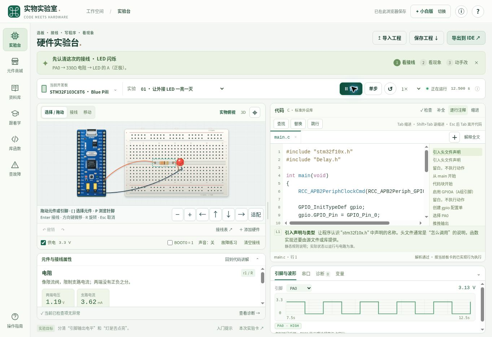

# 硬件实物实验室 V3：十轮审查与修改总记录

日期：2026-11-06。基线为已发布V2（提交`231cc8d0bd89a828800ecd540020bb1eab047e49`），本次目标是落实“每一轮都审查并修改”，提升可读性、学习路径、操作可靠性和文件交接。以下十轮均有真实缺陷、代码修改和对应验证，没有把同一次浏览页面拆成十轮。

## 十轮完成内容

| 轮次 | 主要发现 | 已完成的修改 | 证据 |
| --- | --- | --- | --- |
| 1 界面层次 | 小字、浅字、混杂图标、入口跳错页 | 统一字号/颜色/按钮和SVG导航，扩大分隔条；#library选择模式后保留目标页 | audit-round-01.md；浏览器深链接及模式切换 |
| 2 资料阅读 | 65条资料堆成列表，无阅读起点和已下载区分 | 中文学习路线、组合检索、收藏、最近阅读、作者/官方分区、10份本地PDF预览；默认F103 SPL路线不混HAL | audit-round-02.md；22项资源测试；实际PDF预览 |
| 3 模型细节 | 电阻色环错误、固定假参数、极性和接点不一致 | 999Ω五环、不能精确编码时印字、真实参数标签、LED阴极和电容负极、15类共用针脚坐标、BluePill全部40针 | audit-round-03.md；8项模型测试 |
| 4 接线和移动 | 重接丢ID、取消残留、缩放覆盖丝印、键盘和触屏薄弱 | 保留导线身份，检查重复/同点，可靠取消/释放；拖动/重接/撤销；键盘选件选脚、按钮按住与触屏操作 | audit-round-04.md；12项交互测试；实际接线/拖动/撤销 |
| 5 代码编辑 | 注释误判配置上下文，补全误触宏/注释，缺查找和跳行 | 全文件上下文解释，光标处补全、输入法保护和括号处理；查找/替换/跳行工具 | audit-round-05.md；编辑器专项34项；真实查找替换 |
| 6 参数与诊断 | 无效数值直接写入，滑块一次动作产生多次撤销，故障撤销不还原源码 | 带单位/边界的参数表，原子滑块撤销，实际接线与测量，代码/运行/电路统一诊断，时钟故障源码撤销 | audit-round-06.md；4项工具测试；ADC/非法参数/时钟故障实测 |
| 7 硬件选型 | 搜索被URL和其他型号描述污染，缺比较与引脚索引 | 型号优先、多关键词、独立筛选状态、收藏、2–3板比较、引脚查找、可识别缩略图、BOM校验 | audit-round-07.md；4项索引测试；真实搜索/收藏/对比 |
| 8 小白引导 | 每个实验都让用户“500改1000”，对ADC/按键不适用 | 按实验生成接线/知识点/预测/现象/代码位置，个人观察记录，正确ADC范围，自有工程不套标准答案 | audit-round-08.md；4项引导测试；实际ADC实验卡 |
| 9 工程交接 | 导入可能半应用，路径覆盖，ZIP折叠，注释副本破坏代码 | 预检/预览/应用/撤回，原始ZIP结构与CRC检查，GB18030兼容，合法端点和参数验证，独立读码TXT，IDE逐文件预览 | audit-round-09.md；导入19项；导出及多板24项；真实导入/撤回/Keil预览 |
| 10 整合回归 | 按钮色被reset覆盖、列表重绘丢焦点、窄屏背景可聚焦、画布被挤成121px | 修复选择器、稳定焦点、背景inert与断点恢复、短屏滚动、合并工具栏、画布保底及属性折叠、平板代码宽度和移动引导 | audit-round-10.md；目录事件脚本12场景；桌面/平板/手机实测 |

## 用户现在可以怎样使用

进入后选择小白版，默认保持BluePill F103标准外设库学习路径。左边看接线和实际元件状态，右边写代码和看白话解释；查找、替换、跳行不用滚到下方。每个内置实验的入门步骤与实验卡对应当前目标，先写预测、再运行观察。

商城侧栏中先搜索具体型号，查看该条目是行为仿真还是资料索引；可收藏、比较板卡、查针脚并加入备料清单。资料库提供点灯、输入、排错路线；本地PDF和作者原始入口明确区分。选择PDF可直接在详情区预览，保留原文页码和来源。

导入工程先展示候选板型、文件及接线。应用成功后可撤回；验证失败保留当前工作。IDE导出后直接检查包内文件；源代码不追加讲解文字，逐行说明独立保存。

## 最终验证结论

**最终自动化结果：167通过、0失败、0跳过。** 原V2的60项基线保留。15个测试文件覆盖解析与执行、电路、板型、导出、编辑器、元件绘制、接线事件、参数、目录、学习引导、导入和资源数据。目录键盘脚本在Node统计中作为1项文件测试，内部12个断言场景单独记录，不再重复加总。

**19个自行编写的JavaScript模块通过语法检查。** 10份本地PDF仍存在；资料回归同时检查有效本地路径与PDF头。原始结果见 `qa/v3-test-output.txt`。

真实浏览器已验证：资料页深链接、两种模式及工程保留、官方PDF显示、搜索和收藏、两板比较、查找替换与跳行、ADC旋钮与单步撤销、非法参数、999Ω模型、接线/重接/删除/拖动/撤销、代码类故障还原、导入应用/撤回/错误保全、Keil内容预览、桌面/平板/手机布局及窄屏抽屉恢复。完整操作结果见第10轮，不把自动测试当作视觉验收。

此处原为 V3 私有站点的 PDF 预览截图。公开副本通过资料来源入口查阅该手册。

## 能力数量与实际范围

| 项目 | 当前数量 | 含义 |
| --- | ---: | --- |
| 开发板目录 | 56款 | 可检索的板卡资料，不是56颗芯片完整仿真 |
| 元件/模块目录 | 72项 | 包含资料级条目，卡片标明支持状态 |
| 可执行板型配置 | 9款 | 受支持C/Arduino源码接口的行为模型 |
| 可执行元件类别 | 15类 | 简化集总或行为模型 |
| 预接线实验 | 42个 | 原10个SPL实验与新增8板各4个示例 |
| 资料索引 | 65条 | 中英官方、课程作者与镜像分别标识 |
| 已有本地PDF | 10份 | 可预览文件本体，其余55条仍是在线入口 |

## 本次没有宣称完成的事情

本平台执行受支持源码子集，不装载任意HEX/ELF/BIN，也不是完整CPU、SDK或操作系统仿真。电气模型不覆盖全部温升、烧毁、EMC、接触不良和真实故障；外观绘制不能用于制造。自动检查通过只代表当前检查范围内未发现问题。

当前云环境只完成SVG实物俯视验收，没有可用WebGL作3D GPU画面检验。IDE包的源码、文件引用、芯片设置与页面预览经过检查，但没有在用户本机工具链编译或实体硬件烧录；也没有观察到浏览器Blob下载完成事件，因此不把这些计为已验收。

这些边界继续显示在产品支持状态、模型说明与IDE接入说明中。后续若扩展到真实固件仿真，需要另行引入处理器/外设仿真后端并建立硬件对照测试，不能仅靠增加模型图片完成。
